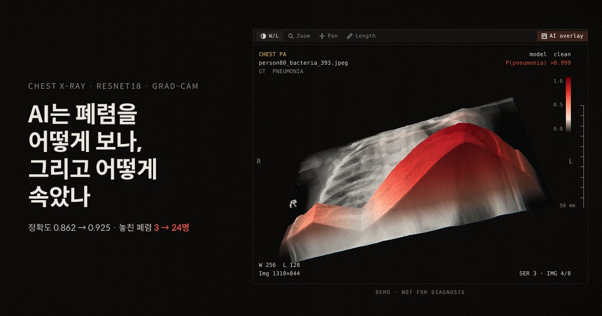
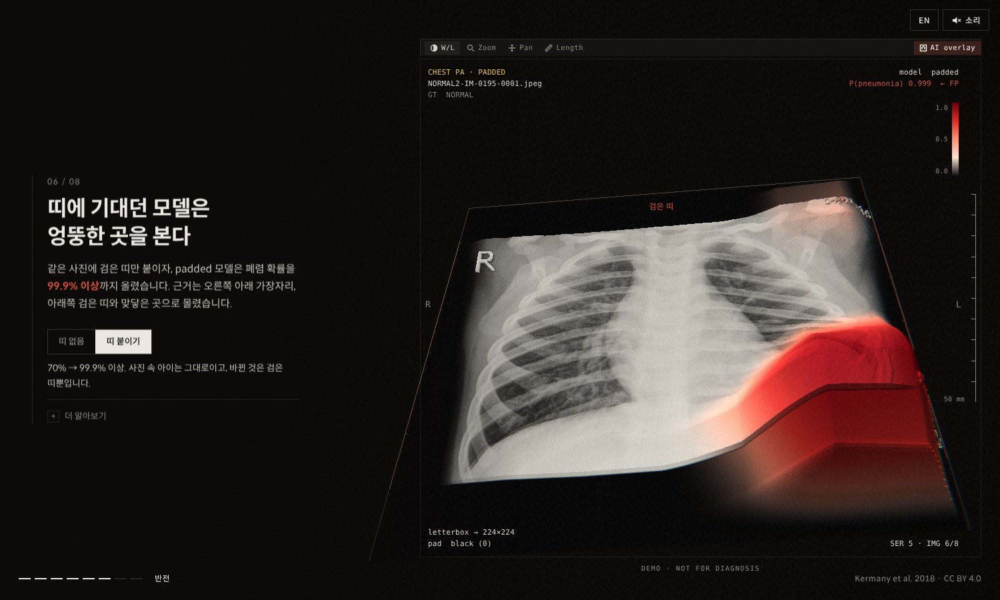
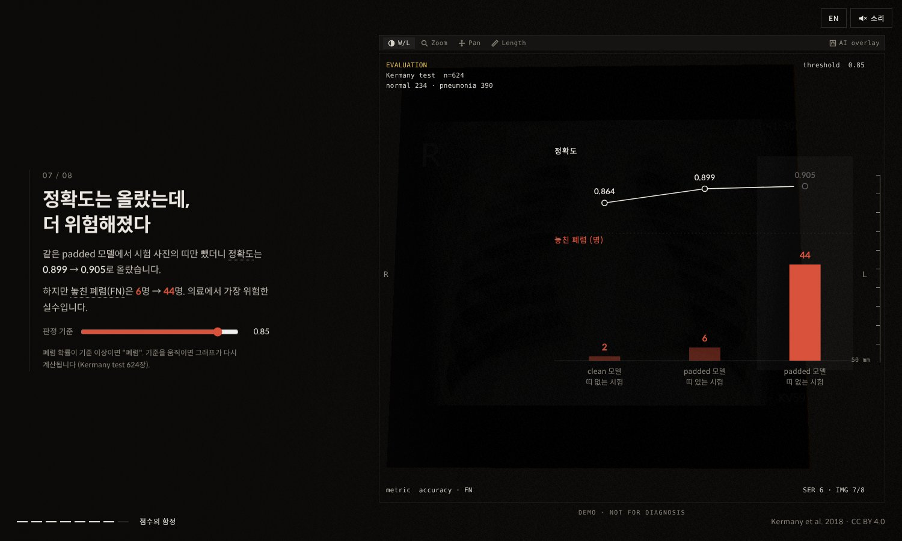

# AI는 폐렴을 어떻게 보나, 그리고 어떻게 속았나

흉부 X-ray 폐렴 분류 모델(ResNet18)이 사진의 어디를 근거로 판단하는지 Grad-CAM으로 보여주고, 학습 사진의 **검은 띠(letterbox 패딩)** 라는 지름길에 속는 과정을 3D 스크롤 페이지로 재현한 프로젝트입니다.

**데모:** https://ten-infosec.github.io/xray-gradcam-story/web/ (한국어 · English · Français · 中文 · 日本語 · Русский · العربية)



## 핵심 발견

| 조건 | 정확도 | AUC | 놓친 폐렴 (FN) | 정상을 폐렴으로 (FP) |
|---|---:|---:|---:|---:|
| clean 모델 · 띠 없는 시험 | 0.8205 | 0.9495 | 1 | 111 |
| padded 모델 · 띠 있는 시험 | 0.8622 | 0.9632 | 3 | 83 |
| **padded 모델 · 띠 없는 시험** | **0.9247** | 0.9756 | **24** | 23 |

Kermany test 624장(정상 234 · 폐렴 390), 판정 기준 0.5.

1. **지름길의 재료가 데이터에 있었다.** 폐렴 사진이 정상 사진보다 가로로 길어서(평균 가로세로 비율 1.51 대 1.23), 정사각형으로 맞추면 검은 띠가 거의 2배 두꺼워집니다(평균 여백 비율 0.32 대 0.18).
2. **정확도는 올랐는데 더 위험해졌다.** 같은 padded 모델에서 시험 사진의 띠만 뺐더니 정확도는 0.862 → 0.925로 올랐지만, 놓친 폐렴은 3명 → 24명으로 늘었습니다.
   같은 조건으로 시드만 바꿔 3번 더 학습하니 놓친 폐렴은 평균 0.3명 → 4.3명이었습니다. 방향은 같지만, 24명은 처음 한 번의 실행에서 나온 숫자입니다.
3. **띠만 붙여도 판단이 바뀐다.** 정상 사진 234장 전부에 검은 띠만 붙여 봤더니, padded 모델의 폐렴 확률이 평균 +0.25 올랐고(82%의 사진에서 상승), 62명은 판정이 "정상 → 폐렴"으로 뒤집혔습니다. 띠를 본 적 없는 clean 모델(대조군)과 비교해 띠 자체의 효과만 볼 수 있습니다.
4. **지름길을 끊는 방법.** 띠 두께를 정답과 상관없이 무작위로 붙이는 **randband** 학습은 띠 유무에 따른 놓친 폐렴 차이를 줄였고(시드 3개 평균 FN 1.0 / 2.0), 띠를 회색으로 채우는 **grayfill**은 정확도는 높지만 놓친 폐렴이 많았습니다(FN 11.3 / 9.7).

5. **근거는 폐 안에 모여 있지 않았다.** 폐 분할 모델로 폐 영역을 찾아 보니, 폐렴 사진 390장에서 Grad-CAM 근거 중 폐 안에 들어간 비율은 clean 31%, padded 34%로 폐 면적 비율(38%)보다도 낮았습니다. padded 모델이 놓친 24장에서는 27%였습니다.

| 학습 방법 (시드 3개) | 시험 | 정확도 | AUC | FN | FP |
|---|---|---:|---:|---:|---:|
| clean | 띠 없음 | 0.823 ± 0.020 | 0.955 | 1.3 | 109.0 |
| clean | 띠 있음 | 0.859 ± 0.077 | 0.975 | 74.7 | 13.3 |
| padded | 띠 없음 | 0.929 ± 0.003 | 0.977 | 4.3 | 39.7 |
| padded | 띠 있음 | 0.807 ± 0.029 | 0.960 | 0.3 | 120.0 |
| randband | 띠 없음 | 0.834 ± 0.030 | 0.968 | 1.0 | 102.3 |
| randband | 띠 있음 | 0.850 ± 0.028 | 0.965 | 2.0 | 91.7 |
| grayfill | 띠 없음 | 0.936 ± 0.005 | 0.976 | 11.3 | 28.7 |
| grayfill | 띠 있음 | 0.924 ± 0.006 | 0.964 | 9.7 | 38.0 |

(`notebooks/02_robustness_fixes.ipynb`, 환자 단위 분할, 판정 기준 0.5)

| 띠 붙이기 토글 | 판정 기준 슬라이더 |
|---|---|
|  |  |

## 페이지 구성

- **스크롤 8장면:** 3D 흉곽(그림자) → 정상/폐렴 → ResNet18 층 → Grad-CAM → 검은 띠 → 반전 → 점수의 함정 → 정리
- **직접 해보기:** 반전 장면의 "띠 붙이기" 토글, 판정 기준 슬라이더(624장 확률로 실시간 재계산)
- **분석 섹션:** 정상 234장 반사실 실험, 지름길 고치기(시드 3개), 폐 안 근거 비율(폐 분할 모델), Grad-CAM · Grad-CAM++ · Score-CAM 비교, 기준과 연동된 624점 혼동행렬, 시험 사진 624장 탐색기(데이터셋 사진만, 업로드 없음)
- **설명:** 용어 툴팁, 장면별 "더 알아보기", 실험 방법과 한계 섹션
- **기타:** 7개 언어(아랍어는 오른쪽→왼쪽 배치), 브라우저에서 실시간 생성하는 배경음(Web Audio, 오리지널), 판독 화면(PACS) 스타일 뷰어

## 실험 방법

- **데이터:** Kermany v2 train 5,232장(정상 1,349 · 폐렴 3,883)을 환자 단위로 약 80:20 분할(같은 환자가 학습·검증에 동시에 들어가지 않게). test 624장은 마지막 채점에만 사용.
- **모델:** ImageNet 사전학습 ResNet18 전체 미세조정. 224×224, Adam(lr 1e-4), 배치 32, 5 에폭, seed 42. 증강은 밝기·대비만(회전·이동은 새 검은 테두리를 만들어 제외).
- **두 전처리:** clean(비율 무시하고 늘림) / padded(비율 유지 + 검은 띠, DACON 학습 조건 재현).
- **Grad-CAM:** layer4 출력(7×7×512)에 "폐렴" 점수의 평균 기울기를 가중치로 곱해 합산, ReLU, 최댓값 1로 정규화.

## 한계

- 7×7 지도라 병변의 정확한 위치가 아니라 대략적인 구역만 보여줍니다.
- 장면 04의 대표 사진은 조건에 맞는 후보 27장 중에서 골랐습니다(탐색기에서 624장 전부 확인 가능).
- 정상 사진에서는 폐렴 근거가 거의 없어 정규화 과정에서 잡음이 커지므로, "테두리 집중 비율"은 근거로 쓰지 않았습니다.
- 스크롤 장면의 숫자는 시드 42 한 번의 실행입니다. 시드 3개 재학습 결과는 위 표와 페이지의 "고치기" 섹션에 따로 보여줍니다.
- 폐 영역은 torchxrayvision의 ChestX-Det PSPNet(성인 데이터로 학습)으로 찾았기 때문에 소아 사진에서는 윤곽이 어긋날 수 있습니다.
- 영어 외 번역은 AI로 만든 뒤 태그만 검증했습니다.
- 세 조건 모두 FP가 많습니다(기준 0.5 고정, 학습·시험 분포 차이 가능성).
- 3D 흉곽은 성인 모델로 만든 연출이며, 진단 목적이 아닙니다.

## 폴더 구조

```
web/             스크롤 페이지 (index.html, data/: 실험 결과·이미지·3D 모델)
notebooks/       Colab 학습·Grad-CAM 노트북
docs/images/     README 이미지
data/            데이터셋·가중치 (GitHub에 올리지 않음)
```

## 출처

- 데이터: Kermany, D., Zhang, K., Goldbaum, M. (2018). Labeled Optical Coherence Tomography (OCT) and Chest X-Ray Images for Classification. Mendeley Data, V2. doi:10.17632/rscbjbr9sj.2 (CC BY 4.0)
- 3D 흉곽 모델: BodyParts3D, © The Database Center for Life Science, CC Attribution-Share Alike 2.1 Japan (단순화한 모델 파일 `web/data/chest.gltf.json`도 같은 라이선스)
- 글꼴: Spoqa Han Sans Neo (SIL OFL 1.1)
- 관련 과제: [dacon-chest-xray-pneumonia](https://github.com/ten-infosec/dacon-chest-xray-pneumonia)

---

**English summary.** (Page available in 7 languages.) A scroll story showing where a ResNet18 pneumonia classifier looks (Grad-CAM) and how a letterbox-padding shortcut fooled it. Removing the black bands from test films raised accuracy from 0.862 to 0.925 while missed pneumonia rose from 3 to 24 (mean 0.3 → 4.3 across three more seeds). Adding bands to all 234 normal films raised the padded model's pneumonia probability by +0.25 on average and flipped 62 of them to pneumonia. Not for diagnosis.
